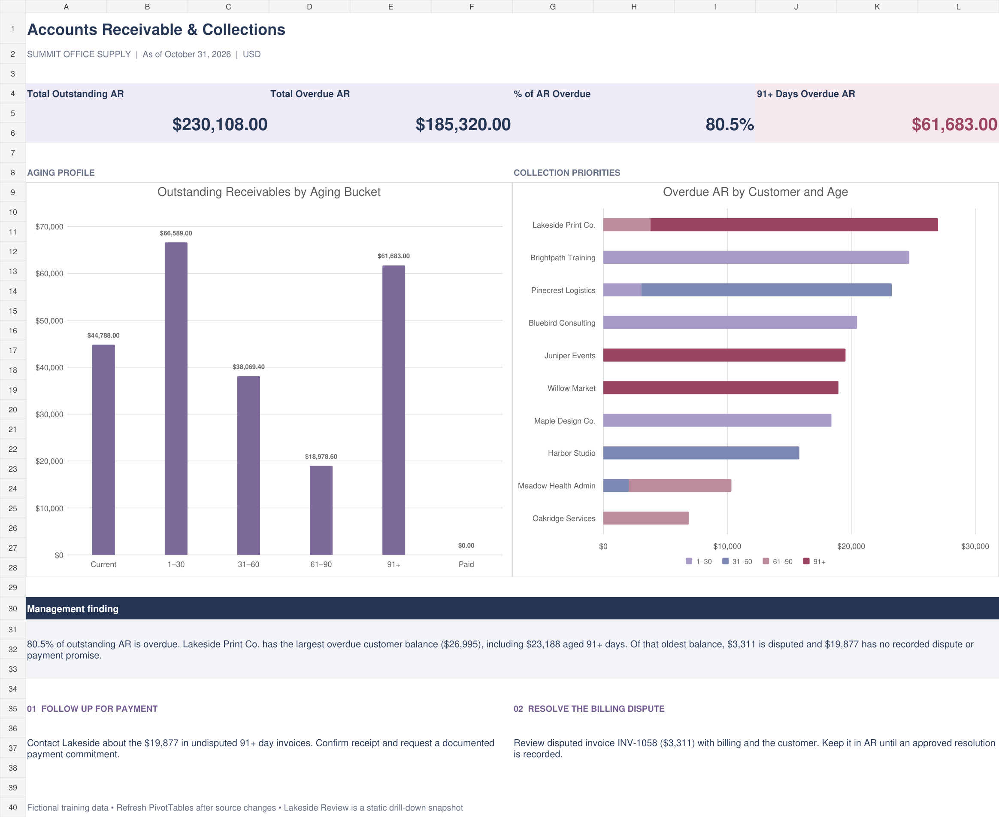

# Accounts Receivable & Collections Analysis

**Author:** Sjockiea Wise  
**Tool:** Microsoft Excel  
**Reporting date:** October 31, 2026  
**Project type:** Guided business analytics portfolio project using fictional data

## Business Understanding

### Business question

Which overdue customer accounts should management prioritize to improve cash flow?

This project turns 60 fictional invoices from 12 customers into an accounts receivable aging analysis, customer collections summary, and management dashboard. It combines my accounting experience with developing Excel analytics skills.

## Demo Link

[Excel workbook](AR_Collections_Practice.xlsx) — downloadable, not a hosted interactive demo.

## Data Understanding

Synthetic invoice-level data: 60 invoices, 12 fictional customers, reporting cutoff October 31, 2026. See [data dictionary](DATA_DICTIONARY.md) for fields and [methodology](METHODOLOGY.md) for calculation assumptions.

## Key Performance Indicators

| KPI | Definition | Value |
|---|---|---:|
| Outstanding AR | Open invoice balances at cutoff | $230,108.00 |
| Overdue AR | Past-due outstanding balances | $185,320.00 |
| Overdue percentage | Overdue AR / outstanding AR | 80.5% |
| Aged 91+ days | Oldest overdue bucket | $61,683.00 |

## Screenshots of Visualizations / Results

**Review note:** Final desktop refresh of revised workbook is pending.

## Technologies

Microsoft Excel — Tables, structured references, IF and SUMIFS formulas, PivotTables, PivotCharts.

## Approach

1. Define the collections business question and reporting cutoff.
2. Organize fictional invoice records and calculate aging measures.
3. Summarize balances by customer and aging bucket.
4. Build dashboard and investigate the largest overdue balance.
5. Document findings, limitations and remaining verification.

## Key Findings

| Metric | Result |
|---|---:|
| Total outstanding AR | $230,108.00 |
| Total overdue AR | $185,320.00 |
| Share of outstanding AR overdue | 80.5% |
| AR aged 91+ days overdue | $61,683.00 |
| Largest overdue customer | Lakeside Print Co. |
| Lakeside overdue balance | $26,995.00 |

Lakeside has $23,188 aged 91+ days, including a $3,311 disputed invoice. The remaining $19,877 in that oldest bucket has no recorded dispute or payment promise. The recommendation is to pursue payment follow-up on those invoices while resolving the dispute separately. A dispute does not remove an invoice from AR.

These are findings from a simulated dataset, not actual business results or achieved collections.

## Skills Demonstrated & Lessons Learned

- Excel Tables and structured references
- Outstanding balance and overdue-day calculations
- Nested IF logic for aging classification
- SUM and SUMIFS dashboard metrics
- PivotTable grouping, filtering, and sorting
- Native PivotCharts and invoice drill-down
- Financial interpretation and collection recommendations

## Setup

Download [AR_Collections_Practice.xlsx](AR_Collections_Practice.xlsx) and open it in desktop Microsoft Excel. GitHub does not run Excel workbooks in the browser.

| Worksheet | Purpose |
|---|---|
| AR Dashboard | Four core metrics, aging and customer charts, and collection recommendations |
| AR Aging Summary | Outstanding balances by aging bucket |
| Customer Collections | Overdue customer balances split by invoice age |
| Lakeside Review | Static drill-down of Lakeside invoices aged 91+ days |
| Invoice Data | Invoice-level source fields and calculated columns in `tblInvoices` |
| Start Here | Scenario, reporting-date control, and original learning instructions |

### Refresh safely

1. Keep the reporting date in `Start Here!B8` at October 31, 2026 to reproduce the published findings.
2. Add any future practice records inside `tblInvoices`; confirm the three calculated columns fill down.
3. Use **Data → Refresh All** to update PivotTables and PivotCharts.
4. Check that Current and Paid remain excluded from Customer Collections.
5. Regenerate drill-down details when needed. Lakeside Review does not refresh automatically.
6. Review the written recommendations after data changes; they describe this fixed historical snapshot.

Formula metrics describe the full invoice table and are not controlled by PivotTable filters. Excel's calculation mode should be Automatic.

## Business Recommendations

Prioritize the oldest undisputed balances for review, resolve disputes separately, and monitor aging concentration. These are proposed actions based on fictional data, not measured collections outcomes.

## Documentation

- [Methodology and formulas](METHODOLOGY.md)
- [Data dictionary](DATA_DICTIONARY.md)
- [Findings and recommendations](FINDINGS.md)

## Validation & Limitations

The data is synthetic and contains no real customers or confidential employer records. This was a guided learning project completed with AI-assisted instruction and presentation refinement. I practiced building the calculations, PivotTables, charts, and interpretation in Excel.

The project does not calculate DSO, bad-debt provisions, collection forecasts, or collection success rates because the necessary supporting data is not included. SQL and Power BI are possible future extensions, not completed deliverables in this version.

## Status

Analysis and documentation are built. A final open-and-refresh check of the revised file in desktop Excel remains pending; see [portfolio progress](../../../Documentation/Portfolio-Progress.md).

## Credits

- **Author:** Sjockiea Wise
- **Data:** Synthetic learning dataset, no real customer records
- **Assistance:** Guided Excel practice with AI-assisted instruction and presentation refinement
- **README standard:** Structured to align with Cisco course documentation guidance; no claim of Cisco endorsement

## Navigation

[Financial Analysis](../README.md) · [Portfolio home](../../../README.md)
