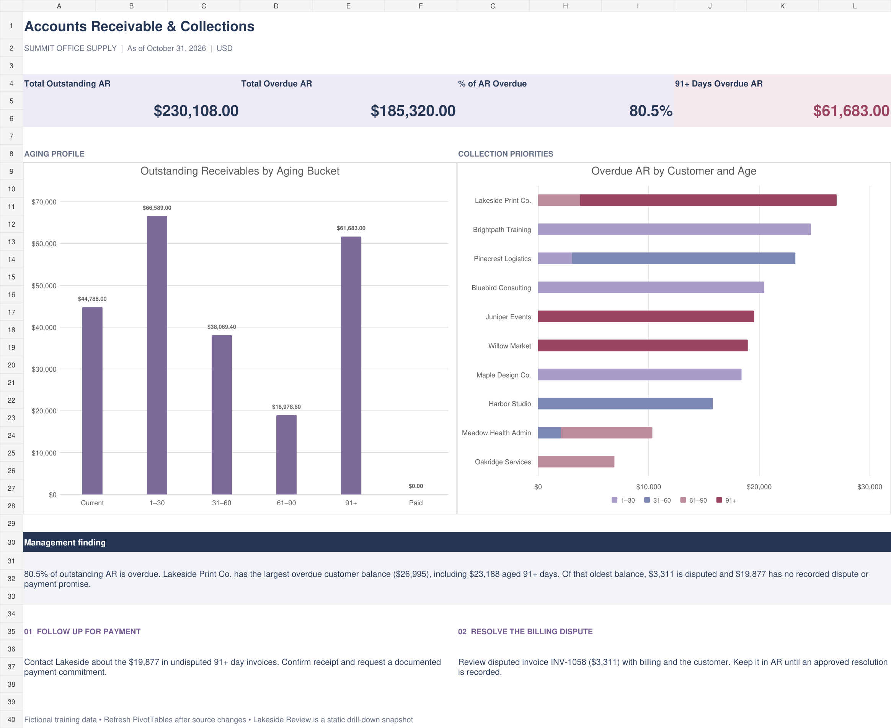

# Business Analytics Portfolio

**Sjockiea Wise | Financial Accountant & Business Analytics Student**

I’m building on my accounting and financial operations experience through practical business analytics projects. My focus is turning business questions into accurate analysis, clear reporting, and useful recommendations.

## Featured project

### [Accounts Receivable & Collections Analysis](Excel-Projects/Financial-Analysis/AR-Collections-Analysis/README.md)

**Microsoft Excel · 60 fictional invoices · 12 customers · October 31, 2026 cutoff**

An invoice aging analysis and dashboard that identifies overdue balances and collection priorities. The analysis found $185,320 overdue out of $230,108 outstanding and investigated a disputed invoice within the largest overdue customer balance.

[View the project](Excel-Projects/Financial-Analysis/AR-Collections-Analysis/README.md) · [Download the workbook](Excel-Projects/Financial-Analysis/AR-Collections-Analysis/AR_Collections_Practice.xlsx) · [Read findings](Excel-Projects/Financial-Analysis/AR-Collections-Analysis/FINDINGS.md)

**Status:** Analysis built and documented through a guided learning project. Source calculations and saved totals were reviewed; a final open-and-refresh check of the revised workbook in desktop Excel remains pending. Results use synthetic data and do not represent actual collections.

## Creator Economy & Influencer Analytics (planned)

A new specialization covering content and audience analytics, brand partnership reporting, affiliate earnings, creator financial analysis, and executive dashboards. **Twelve projects (31–42) are currently planned; no completed creator dashboards or client outcomes are claimed.**

[Explore the Creator Economy Analytics project roadmap](Creator-Economy-Analytics/README.md) · [Track project status](Creator-Economy-Analytics/PROJECT-STATUS-TRACKER.md)

## Portfolio Organization & Project Types

Every project has **one primary home** and may be referenced from several technical, domain, platform, industry, or AI indexes. Work is classified as **Standalone**, **Extension**, or **Integrated case study** so related projects show new skills without duplicating evidence.

[Read the organization and classification guide](Documentation/Portfolio-Organization.md) · [View the project roadmap](Documentation/Project-Roadmap.md)

## Additional Specializations (planned)

| Specialization | Purpose | Status |
|---|---|---|
| [AI & Predictive Analytics](AI-and-Predictive-Analytics/README.md) | AI-assisted reporting, forecasting, machine learning, automation, and applications; [21 idea classifications](AI-and-Predictive-Analytics/PROJECT-RELATIONSHIPS.md) | 21 planned |
| [Industry-Specific Analytics](Industry-Specific-Analytics/README.md) | Industry-based case studies and cross-references | Planning index |
| [Platform-Specific Analytics](Platform-Specific-Analytics/README.md) | Platform-based case studies and cross-references | Planning index |

## Browse the portfolio

| Area | What is available |
|---|---|
| [Excel Projects](Excel-Projects/README.md) | AR analysis, workbook, dashboard, and supporting documentation |
| [Financial Analytics](Financial-Analytics/README.md) | Subject index linking to the AR project |
| [SQL Projects](SQL-Projects/README.md) | Learning direction; no SQL deliverables published yet |
| [Power BI Projects](Power-BI-Projects/README.md) | Learning direction; no Power BI deliverables published yet |
| [Python Projects](Python-Projects/README.md) | Learning direction; no Python deliverables published yet |
| [Marketing Analytics](Marketing-Analytics/README.md) | Future campaign, customer, and ROI project ideas |
| [Business Case Studies](Business-Case-Studies/README.md) | Approach to case studies and recommendations |
| [Entrepreneurial Business Analytics](Entrepreneurial-Business-Analytics/README.md) | Future applications across my business interests |

Each actual project has one canonical folder. Tool, domain, industry, platform, and AI indexes cross-reference that folder rather than duplicate its files. Future ideas live in the [project roadmap](Documentation/Project-Roadmap.md).

## Skills and evidence

The AR project demonstrates practice with Excel Tables, structured references, IF, SUMIFS, PivotTables, PivotCharts, aging analysis, and financial interpretation. SQL, Python, and Power BI are developing learning areas, not claims of completed portfolio work.

## Project documentation

[Progress](Documentation/Portfolio-Progress.md) · [Methodology](Documentation/Analytical-Methodology.md) · [Data sources](Documentation/Dataset-Sources.md) · [Documentation standards](Documentation/Project-Documentation-Standards.md)

## Related repositories

- [Business Analytics Technology](https://github.com/Evolve-with-Kiea/Business-Analytics-Technology) — learning and technical development
- [Business Analytics Resource Library](https://github.com/Evolve-with-Kiea/Business-Analytics-Resource-Library) — reference material

Availability of related repositories depends on their own visibility settings.
